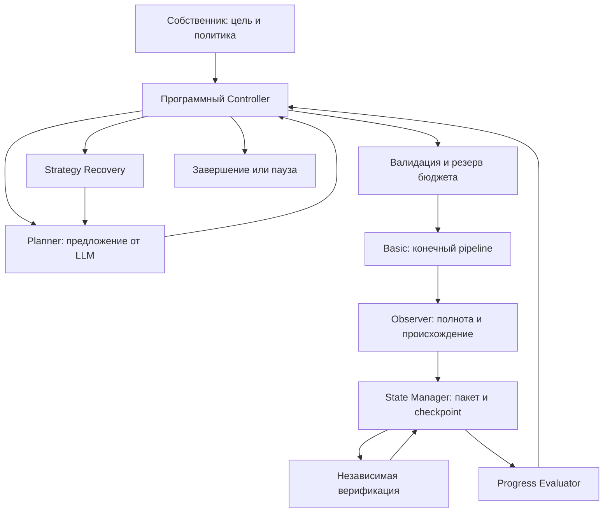

# TheCycle — архитектурная концепция v0.2

**Дата:** 26.11.2026. **Статус:** проектная архитектура, не описание реализованной системы.  
Основание: обсуждение Endless Pipeline 25.11.2026 и [архитектурное ревью 26.11.2026](../../review/2026-11-26/TheCycle-architecture-review.md). Исходный отдельный файл концепции не найден; эта редакция восстанавливает согласованные принципы и нормативно включает пять замечаний TC-R01–TC-R05. После утверждения служит точкой входа для разработчика. Историческое ревью сохраняется неизменным.

## 1. Для собственника

TheCycle — управляющая надстройка над Basic для исследования задачи, длительность которого заранее неизвестна. Basic по-прежнему исполняет один конечный pipeline; надстройка после каждого цикла решает, продолжать ли исследование, повторить ли схему, сменить ли стратегию, проверить ли вывод или завершить работу. Число циклов не задаётся заранее; однако время, расход ресурсов, права доступа и способы остановки ограничены политикой собственника.

Принципиальное изменение: ни одна LLM не получает власть над исполнением. Она предлагает гипотезы и планы; программный контроллер проверяет их допустимость, управляет ресурсами и сохраняет состояние. Модель не вправе сама объявить задачу решённой. Каждый цикл приносит проверяемое изменение состояния или явный отчёт об отсутствии прогресса. Синтез облегчает чтение, но не заменяет первичные доказательства.

Собственник задаёт цель, критерий успешного завершения, допустимый бюджет, режим подтверждений и уровень доказательности; получает текущие результаты, расход, открытые вопросы, последнюю подтверждённую версию и причину каждого перехода. При остановке накопленное знание не теряется. Новый бюджет может разрешить возобновление той же исследовательской сессии.

## 2. Архитектура: три слоя

| Слой | Компоненты | Ответственность |
| --- | --- | --- |
| Управляющий | Controller, Policy, Observer, Progress Evaluator, Strategy Recovery, Planner, Verification | Принятие решений, проверки, бюджет, восстановление, предложения новых стратегий и оценка результата. |
| Исполнительный | Basic Engine + адаптер | Выполнение одного валидированного конечного pipeline. Без изменения Basic ради TheCycle; только поддерживаемые возможности. |
| Информационный | State Manager, журнал исполнения, хранилище артефактов и граф зависимостей | Версии знаний, первичные результаты, пакеты циклов, checkpoints, происхождение и восстановление. |



Observer фиксирует факты исполнения и целостность пакета; не определяет математическую истинность. Planner и оценщики могут использовать LLM, включая локальную модель (кандидат Qwen 3.5 9B), но ни конкретная модель, ни её производительность не являются предпосылкой корректности контроллера. Детерминированная политика означает одинаковое управляющее решение при одинаковых входном состоянии, предложении и политике, а не одинаковый текст LLM.

## 3. Конечный автомат управляющего слоя (TC-R01, TC-R05)

Состояние хранится вне контекстов моделей. Нормальный переход:
Initialize → Strategy → Design → Validate → Execute → Audit → CommitState → Evaluate → Decision. При необходимости Decision → Verify → CommitState → Evaluate; при смене плана Decision → Strategy/Design. Ошибка переводит в Recover или Pause; допустимый итог — Completed. Отдельное состояние WaitOwner сохраняет ожидаемое решение собственника. Переходы выполняет только Controller.

| Предложение | Нормативное действие |
| --- | --- |
| CONTINUE | Следующий разрешённый шаг текущего плана исследования. |
| REPEAT_PIPELINE | Новый цикл с той же валидированной схемой и актуальным входным пакетом. |
| GENERATE_PIPELINE | Создать кандидат схемы; исполнение только после Validate. |
| CHANGE_STRATEGY | Зафиксировать барьер и выбрать новое направление; затем Design. |
| VERIFY | Независимый проверочный pipeline или формальный инструмент. |
| COMPLETE | Завершение с итоговым статусом после проверки критерия успеха. |
| STOP | Остановить исследование, сохранить результат и причину. |
| WAIT_OWNER | Пауза до явного решения собственника. |

Внутренние названия действий — проектный контракт, не существующий API Basic. Соответствия с ревью: REPEAT=REPEAT_PIPELINE; SWITCH_STRATEGY=CHANGE_STRATEGY; RUN_VERIFICATION=VERIFY; FINISH=COMPLETE (завершение не равно успеху); PAUSE=пауза контроллера; ASK_OWNER=WAIT_OWNER. STOP собственника и исчерпание жёсткого лимита имеют приоритет над любым предложением LLM.

Перед каждой отправкой Controller проверяет согласованную версию состояния, единоличное владение исполнением, схему, доступность транспорта, права, контекст и резерв бюджета. Неверный JSON, неизвестный переход или отсутствующий источник не исполняются. Число исправлений ограничено; после него — пауза или безопасное завершение. Изменять политику бюджета может только авторизованный собственник/программная политика.

## 4. Информационный слой и пакет цикла (TC-R02)

Пакет — неизменяемый манифест изменения знаний, а не полный пересказ всей переписки. Источники сохраняются в отдельном хранилище; манифест содержит ссылки. Минимальный проектный пример:

```json
{
  "schema_version": 1,
  "research_id": "r001",
  "cycle_id": 12,
  "parent_state_version": 11,
  "pipeline_ref": "p03:v4",
  "run_id": "basic-012",
  "source_refs": ["raw-012-01", "raw-012-02"],
  "knowledge_delta": [
    {
      "claim_id": "c017",
      "revision": 2,
      "status": "CANDIDATE",
      "statement": "Утверждение с явными условиями",
      "evidence_refs": ["raw-012-01"],
      "depends_on": ["c004:v1"],
      "verification_refs": []
    }
  ],
  "open_obligation_refs": ["o003"],
  "contradiction_refs": [],
  "resource_delta": {"model_calls": 2},
  "integrity": {"algorithm": "SHA-256", "digest": null}
}
```

digest=null допустим только в черновике; перед фиксацией требуется вычислить SHA-256 по канонически сериализованному манифесту без поля integrity.digest и проверить контрольные суммы адресуемых объектов. Алгоритм канонизации должен быть зафиксирован в реализации (например RFC 8785). Хеш не является доказательством истинности и не обнаруживает смысловые дубликаты.

State Manager владеет постановкой задачи, критериями успеха, гипотезами, подтверждёнными знаниями, отвергнутыми утверждениями, противоречиями, открытыми вопросами, версиями pipeline, решениями контроллера и учётом ресурсов. Статусы утверждений: CANDIDATE, VERIFIED, REFUTED, STALE, UNRESOLVED. VERIFIED требует принятого свидетельства соответствующего уровня; REFUTED сохраняет контрпример; STALE маркирует зависимость от утратившего силу основания. Старые версии не удаляются.

Переход между циклами передаёт релевантную выборку по ссылкам, а не нарастающий общий prompt. Выборка включает точную постановку, ограничения, нерешённые обязательства, выбранные доказательства и контрпримеры. При невозможности уложить достаточное свидетельство в контекст — разбить проверку или остановиться с явной причиной. Сжатие не должно заменять оригиналы.

## 5. Независимость и критерий завершения (TC-R03)

Генератор и проверяющий исполняют разные роли. Проверяющему передаются исходная постановка, точное утверждение и доказательные материалы без подсказки о предпочтительном вердикте, если это возможно. Независимость контекста подтверждается транспортом, а не названием роли. Модельный консенсус не равен доказательству. Формальный верификатор (например Lean) применяется, когда доступен и соответствует математической задаче; проверяются также предпосылки формализации. Если его нет, явно фиксировать уровень независимой экспертной проверки и оставшиеся обязательства.

COMPLETE проверяется кодом по результатам принятой верификации и критерию собственника. Итоговые статусы: VERIFIED_SOLUTION, PARTIAL, INCONCLUSIVE, BUDGET_EXHAUSTED, CANCELLED, ERROR. VERIFIED_SOLUTION недопустим при незакрытом обязательстве, противоречии или отсутствующем необходимом свидетельстве. При отсутствии доказательства система вправе закончить исследование, но не объявить доказанную теорему.

## 6. Прогресс и выход из тупика (TC-R04)

Прогресс — измеряемое изменение состояния знаний, а не количество сообщений. Оценщик формирует вектор: новые проверенные утверждения, закрытые обязательства, опровергнутые гипотезы, новые барьеры, противоречия, повторения, расход. Счётчики определяются по уникальным атомарным утверждениям с версией и статусом. Точное совпадение выявляется кодом; смысловая эквивалентность — кандидаты от семантической проверки с подтверждением, особенно при изменённых условиях. Нельзя удалять разные гипотезы только по близости эмбеддингов.

Политика оценивает вектор на окне циклов, учитывает стоимость и признаки стагнации. Пороговые значения, размер окна и веса — параметры экспериментальной калибровки, не утверждённые числа. Прогресс не обязан быть монотонным: опровержение ошибочной ветви полезно.

При стагнации Strategy Recovery фиксирует барьер, проверяет уже исчерпанные методы, выбирает ограниченную разведку альтернативного представления/аппарата/декомпозиции и критерий успеха. При неудаче откатывается выбор активной стратегии, но не удаляются знания или отрицательные результаты. Дальнейшие попытки ограничены ресурсной политикой. В отсутствие перспективных направлений допустимо INCONCLUSIVE или WAIT_OWNER.

Связанные спецификации MATH-01, MATH-02 и MATH-03 разработаны отдельно; их расположение в репозитории не установлено, поэтому ссылки не выдумываются.

## 7. Исполнение, фиксация и recovery

Один цикл: загрузка последней зафиксированной версии → валидация схемы и резерв ресурсов → запись намерения исполнения → запуск Basic → приём результата Observer → сохранение первичных объектов → атомарная фиксация пакета и версии → верификация → оценка → сохранение следующего управляющего решения. Верификация может потребовать собственного конечного цикла.

Инварианты: один активный владелец исполнения на research_id; стабильные идентификаторы внешних попыток; новая версия состояния принимается только относительно актуального родителя; переход и решение фиксируются согласованно; при сбое незакоммиченные результаты не считаются подтверждёнными. Реестр отправок хранит состояния NOT_SENT, SENT, ACCEPTED, UNKNOWN. UNKNOWN после сбоя требует сверки с провайдером или оператором; автоматическая слепая повторная отправка запрещена. Система обеспечивает идемпотентное принятие результатов, но не обещает exactly-once внешней отправки без поддержки провайдера.

Бюджет проверяется глобально, а не только на уровне одного Basic. Резервируется верхняя граница разрешённых ресурсов, в том числе вызовов и повторов; если стоимость/время нельзя надёжно определить, применяется консервативный лимит и остановка. Неопределённый исход вызова учитывается до сверки. Команда Stop отменяет новые отправки, пытается отменить текущие и сохраняет состояние; прекращение внешней генерации не гарантируется при отсутствии поддержки транспорта. Ограничение maxLoops Basic сохраняется; 51-й и последующие **внешние** циклы разрешены при соблюдении общей политики.

## 8. Реализация без дублирования Basic

В main Basic ограничен конечным списком шагов. [PR №3](https://github.com/AlGold777/AutoOrchestr/pull/3) содержит кандидаты для переиспользования: маршруты, gate, checkpoint/resume, версии артефактов. PR черновой; транспорт независимых участников и браузерная приёмка не завершены. TheCycle не должен зависеть от ещё не принятой функции без явно проверяемого адаптера возможностей.

Минимальные этапы:
1. Контракт адаптера Basic: validate, execute, cancel/reconcile при наличии поддержки; описание фактических возможностей.
2. State Manager + журнал + тесты восстановления и целостности.
3. Controller + Policy + Observer; сначала фиксированный pipeline и управляемое повторение без LLM-планирования.
4. Независимая верификация, Progress Evaluator и Strategy Recovery; затем генерация схем.
5. Сквозная проверка реальных вкладок, лимитов, сбоев и длительных прогонов. Экспериментальное сравнение стратегий на одинаковом бюджете.

Не создавать второй исполнительный движок. Если API Basic не предоставляет необходимый контракт, зафиксировать интеграционный блокер и отдельно согласовать минимальную адаптацию вместо скрытого изменения Basic.

## 9. Трассировка ревью и допуск

| Замечание | Исправление в концепции | Приёмка (см. ревью) |
| --- | --- | --- |
| TC-R01 | §§2–3, 7: программная власть и политика | TC-A01, A09, A10, A12 |
| TC-R02 | §§4, 7: первичные объекты, версии, зависимости, журнал | TC-A03, A07, A08, A11 |
| TC-R03 | §5: независимость и доказательная проверка | TC-A05, A06 |
| TC-R04 | §6: измерение прогресса, дубликаты, смена метода | TC-A04 |
| TC-R05 | §§3, 7–8: предварительная валидация, внешний цикл, бюджет | TC-A01, A02, A06, A09 |

Все пять замечаний включены в проектную архитектуру. Это закрытие на уровне концепции, не подтверждение исправления реализации. Решение NO-GO для автономной эксплуатации сохраняется до выполнения обязательных приёмочных сценариев. После успешной технической приёмки допустим ограниченный пилот; математическая эффективность подтверждается отдельным экспериментом. Пороговые значения, схема хранения и детальная интеграция требуют выбора при реализации. Код не изменён, тесты не запускались.

## 10. Дополнение к архитектуре: обязательные контракты долговечности и интеграции (26.11.2026)

Следующие положения уточняют §§2–9 и обязательны для реализации. Они не означают, что соответствующий код уже существует.

1. **MV3 lifecycle и автономность.** `background/index.js` — classic service worker с собственной процедурой сброса volatile storage на обновлении. TheCycle использует отдельный durable namespace и IndexedDB; ни обновление, ни worker wake не могут стереть research state, бюджет, stop-флаг и сведения о бэкапах. Длительный цикл не должен зависеть от непрерывной жизни worker: действия разбиваются на короткие идемпотентные переходы, пробуждаемые событиями и `chrome.alarms`.
2. **Файловые бэкапы.** Сохранять версии на компьютере пользователя с интервалом 10 минут (с поправкой на сон браузера) и обязательно после каждого завершённого цикла. Хранить SHA-256, связь `packetCommitId → backupId`, результат readback и состояние ошибки долговечно. Пока обязательный файл не записан и не проверен, следующий цикл запрещён. `chrome.downloads` сам по себе не даёт проверяемого чтения содержимого файла: необходим доказанный readback-capable sink либо явное изменение контракта. Восстановление — из файла с проверкой целостности и атомарным импортом, без автоповтора UNKNOWN.
3. **Граница внешней отправки.** Journal/outbox intent, reservation и fencing проверяются до фактического transport action. Между IndexedDB-транзакцией и внешним сайтом нет распределённой атомарности; поэтому exactly-once delivery не обещается, takeover не должен провоцировать второй send, а неразрешённый исход переводится в RECONCILE.
4. **Авторизация команд.** Содержимое страницы, модельный ответ и входные артефакты — недоверенные данные. Изменение бюджета, запуск, остановка, смена стратегии, restore и takeover разрешены только валидированным командам владельца из доверенного extension UI. Никакие инструкции внутри результатов моделей не исполняются контроллером.
5. **Разделение уровней проверки.** Техническое принятие ответа, подтверждение отдельного контекста verifier, проверка evidence и VERIFIED_SOLUTION — четыре разных события. Статусы Claim (`CANDIDATE/VERIFIED/REFUTED/STALE/UNRESOLVED`) не смешивать с исходами проверки или финальными статусами исследования.
6. **Миграции и диагностика.** Версионировать schema Basic, CyclePacket, event journal, backup envelope и verifier contract. При неизвестной версии — PAUSED/read-only, экспорт без потери данных. Журнал содержит `researchId/cycleId/runId/batchId/epoch/eventId`; секреты и cookie исключены из бэкапов и диагностических экспортов.
7. **Критерий допуска.** Проверить технические сценарии TC-A01–TC-A12, CT01–CT12 и дополнительные T01–T20 из [ТЗ рабочей ветки](https://github.com/AlGold777/AutoOrchestr/blob/thecycle/c01-basic-adapter/docs/TheCycle-remaining-work-technical-spec-2026-11-26.md). Особое внимание: падение между commit и backup, повторная отправка после restart, конкуренция владельцев, 60 последовательных внешних циклов, потеря raw artifacts из-за квоты и независимость verifier.

**Открытые проектные решения:** проверяемый файловый sink в Chrome MV3, политика хранения копий, пределы ресурсов, уровень независимости верификации и критерии VERIFIED для разных классов задач. Без их разрешения нельзя объявлять архитектуру полностью готовой к автономной эксплуатации.
