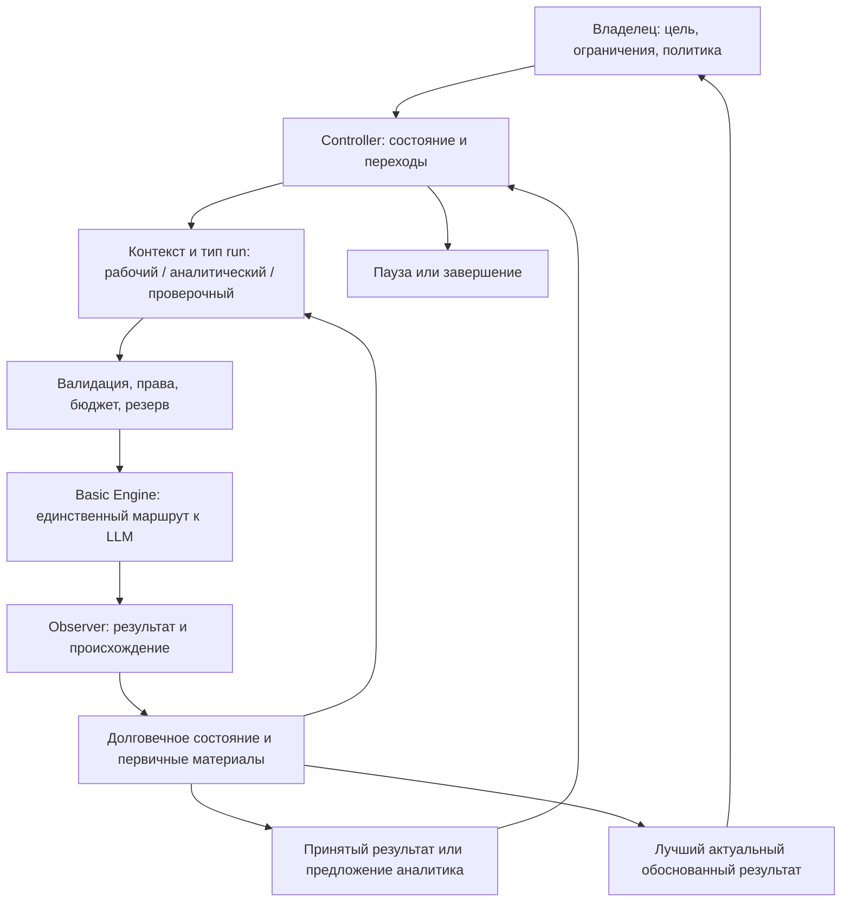

# TheCycle — архитектурная концепция v.0.3

**Дата:** 27.11.2026  
**Статус:** расширенная проектная архитектура. Не является сертификатом готовности продукта или изменением глобального плана.  
**Основание:** архитектура v0.2, решения координатора и эксперименты G1–G3 от 26–27.11.2026.  
**Область:** управляющий слой автономного исследования над существующим Basic Engine.

Документ развивает [архитектуру v0.2](https://github.com/AlGold777/AutoOrchestr/blob/docs/thecycle-architecture-review/docs/Architecture/TheCycle/README.md). Он не изменяет [глобальный план G1–G5](https://github.com/AlGold777/AutoOrchestr/blob/codex/zero-test-failures/docs/TheCycle-GLOBAL-PLAN.md), не создаёт новые обязательные этапы и не является заданием немедленно реализовать все описанные механизмы. В тексте различаются подтверждённые наблюдения, решения текущего этапа и целевые свойства будущей архитектуры.

## 0. Главное архитектурное изменение

TheCycle — не бесконечный pipeline и не последовательность дискуссий нескольких LLM. Это система управления исследованием, в которой объект управления — **состояние решения задачи и знания о нём**, а не количество циклов, ответов или объём сгенерированного текста.

Первоначальная архитектура уже определяла управляющий слой, долговечное состояние, проверку, прогресс и смену стратегии. Эксперименты показали, почему эти функции должны быть связаны более тесно. Правильный результат может присутствовать в истории и исчезнуть из итоговой сводки. Новый метод может дать результат, недоступный в повторении прежней схемы. Независимая проверка отдельного кандидата не устанавливает глобальной оптимальности. План, полезный по смыслу, может оказаться неисполняемым по бюджету.

Поэтому управляющий слой должен отвечать не только на вопрос «какой pipeline запустить следующим», но и на вопросы: что именно уже установлено; на каком основании; что остаётся неизвестным; какой метод наиболее уместен; какие ресурсы он потребует; что позволит считать исследование завершённым.

Цель — повысить вероятность достижения обоснованного решения в пределах ресурсов и сохранить достигнутое. Улучшение качества не гарантируется самой архитектурой и требует экспериментального подтверждения.

## 1. Фундамент v0.2 и уточнения v0.3

| Аспект | v0.2 | v0.3 |
|---|---|---|
| Объект управления | Цикл, состояние, знания | Состояние задачи: обязательства, утверждения, доказательства, неопределённость, стратегия |
| Исполнение | Конечный Basic pipeline | Тот же Basic исполняет рабочие, аналитические и проверочные раунды |
| Информация | Пакеты, артефакты, граф зависимостей | Разделены первичный журнал, накопленное знание, контекст и публикуемый ответ |
| Прогресс | Новые утверждения, проверки и противоречия | Дополнительно сохранность обоснованных результатов, покрытие обязательств, регрессия |
| Стратегия | Planner, Strategy Recovery | Управление гипотезами о методе, декомпозиция нерешённого, границы и цена следующего шага |
| Проверка | Независимый verifier | Различение технического выполнения процедуры, экспертной проверки и формального доказательства |
| Бюджет | Лимиты и резерв | Учитывается цена рабочих, аналитических, проверочных операций и обязательного завершения |
| Завершение | COMPLETE под контролем кода | Раздельно учитываются завершение исполнения, полнота решения и уровень его доказанности |

v0.3 не отменяет инварианты v0.2: единственный владелец исполнения, durable intent, запрет слепого повтора UNKNOWN, версионирование, проверяемый backup, защита от недоверенных данных, сохранение исходных материалов и разделение технической и смысловой проверки. Предшествующие контракты действуют там, где не уточнены этой концепцией.

## 2. Экспериментальное основание

### 2.1. Источники и уровни подтверждения

При подготовке прочитаны архитектура v0.2, глобальный план, manifest, circle-context.js, circle-runtime.js, controller.js в доступной рабочей ветке. Manifest показывает 2.81.1120. В прочитанном controller.js действует fixedPolicy. Более поздние версии 2.81.1121–2.81.1131, включая circle-policy.js, известны из сообщений координатора; их исходники в этой редакции независимо не проверены. Это расхождение доступных версий, а не доказательство отсутствия G3 в поздней сборке.

Материалы:

- [Архитектура v0.2](https://github.com/AlGold777/AutoOrchestr/blob/docs/thecycle-architecture-review/docs/Architecture/TheCycle/README.md), включая дополнение от 26.11.2026, [d49ee58](https://github.com/AlGold777/AutoOrchestr/commit/d49ee5819ecee22dc75592dbc2122e99dff8e955).
- [Глобальный план и фактический реестр проверок](https://github.com/AlGold777/AutoOrchestr/blob/codex/zero-test-failures/docs/TheCycle-GLOBAL-PLAN.md).
- [Материалы живых прогонов G1](https://github.com/AlGold777/AutoOrchestr/tree/codex/zero-test-failures/docs/pipelines/Circle_2026-11-26/notes).
- [G2.1, 643a73ee](https://github.com/AlGold777/AutoOrchestr/commit/643a73ee), по отчёту координатора: 98/98 TheCycle, 476 наборов Jest без падений.
- [Выбор сохранённой Basic-схемы, 66b2365a](https://github.com/AlGold777/AutoOrchestr/commit/66b2365acf0e1cbef0e3279bf22a2e3c53b590cc); коммит прочитан, 477 наборов Jest без падений по отчёту координатора.
- [Два режима формирования контекста](https://github.com/AlGold777/AutoOrchestr/blob/66b2365acf0e1cbef0e3279bf22a2e3c53b590cc/disput/thecycle/circle-context.js).
- Сообщения координатора о G2.2 и G3 от 26–27.11.2026. Полные сырые ответы и журналы этих прогонов не переоценивались независимо.

### 2.2. Установленные наблюдения и их смысл

| Наблюдение | Результат | Архитектурное следствие |
|---|---|---|
| G1: сохранение и Stop | В восьми исследованиях наблюдались реальное исполнение, Stop и отсутствие дублей в экспортированных журналах. Reload 2.81.1118: результат и 375 событий не изменились, новых отправок нет | Состояние должно существовать вне чатов и страницы. Техническая непрерывность необходима для смысловой |
| G2: внешний цикл | Четыре последовательных цикла одной модели в базовой серии; наблюдалась передача предыдущих ответов | Внешний цикл над Basic практически осуществим, но это не доказательство роста качества |
| G2.1: контекст | Реализованы all-evidence и latest-summary; во втором режиме передаётся только итоговая сводка предшествующего цикла, оригиналы сохраняются | Хранение и передача знания — разные задачи |
| G2.2 A, задача 1 | GPT: R1=22/22, R2=22, R4–R6=22, R7–R9=1, R10=13. Claude: R1=11, R3–R9=22. При null в итоговых полях правильные наборы оставались в тексте | Регрессия итоговой проекции без доказанного опровержения. Необходимо отделять сохранение кандидатов от статуса их доказанности |
| G2.2 C | Claude заменён на DeepSeek из-за лимитов; сообщён старт C с аналитиком и выбытием DeepSeek | Состав участников и управляющая политика изменились: такой прогон нельзя считать чистым сравнением режимов контекста |
| G3, первый живой прогон, задача 2 | GPT+DeepSeek, проверяющий Gemini, latest-summary, лимит 20. Цикл 1 — 5/22; после CHANGE_STRATEGY исполнена девятираундовая схема; цикл 3 — 13/22, top3 верны, робастный оптимум не установлен | Динамическая смена схемы практически исполнена, в конкретной траектории выросла точность. Причинный эффект отдельно не измерен |
| G3, тот же прогон | Следующая схема требует 7 вызовов при остатке 6; отклонение до отправки и пауза | Детерминированный бюджетный шлюз необходим: аналитик не всегда выбирает исполнимый план |
| G3, интеграция | По отчёту, исправлены метка доставки, правила ссылок и очистители ответов, повреждавшие имена моделей, ссылки и отступы | Управляющий JSON и происхождение свидетельств должны доходить до валидатора без смыслоразрушающей обработки |
| G4, резервирование | После reload расширения потеряно разрешение на каталог; фон не может запросить его самостоятельно | Автономность ограничивается внешними правами; система обязана объяснимо приостанавливаться |

### 2.3. Экспериментальные задачи

Задача 1: 12 проектов, выбор 5, 792 исходные комбинации, 89 допустимых. Эталонные top3: ACHIJ (100), CEGHK (96), BCDFJ (94); робастный BCDFJ (77). GPT High получил полный численный результат сразу. Задача оказалась слишком простой для измерения роста GPT, но пригодной для исследования удержания результата и регрессии.

Задача 2: 20 проектов в пяти группах, 1024 исходные комбинации, 365 допустимых. Эталонные top3: CHJMQ (123), CFJMQ (119), DEJNR (119); робастный BEJOR (96). Эталон пересчитан координатором полным программным перебором вне исследовательских прогонов. Исследователям запрещено исполнять код, применять калькуляторы, внешние сервисы и поиск; алгоритм для воспроизводимости разрешается написать.

22 численных поля оцениваются механически, обоснование и алгоритм — отдельно. Правильное число не доказывает глобальную оптимальность; описание корректного алгоритма не свидетельствует о его исполнении. Поэтому 22/22 — точность численной проекции по внешнему эталону, а не сертификат VERIFIED_SOLUTION.

Запланированный сопоставимый дизайн: A — Classic, 10 раундов; B и C — по 5 рабочих циклов с двумя раундами на цикл (GPT+Claude, затем GPT); по 15 рабочих вызовов; B — all-evidence, C — latest-summary. Если аналитические и проверочные вызовы включаются, они также должны учитываться при сравнении общих бюджетов. Одинаковыми должны быть состав моделей, настройки, правила инструментов, свежесть контекстов и допустимые повторы. B/C изолирует режим контекста только при совпадении остальных условий; A/B дополнительно различаются границами исполнения.

**Граница вывода:** полные сопоставимые результаты A/B/C обеих задач отсутствуют. Второй прогон G3 с лимитом 40 запущен, но результат VERIFY/COMPLETE не получен. Не доказано превосходство latest-summary, отсутствие регрессии в Circle, причинное преимущество адаптивной смены стратегии или готовность независимой верификации. Эксперименты обосновывают необходимость соответствующих архитектурных механизмов, но пока не доказывают их эффективность в общем случае.

## 3. Состояние исследуемой задачи — центральная сущность

Логически состояние исследования S можно представить так:

```text
S = (Goal, Obligations, Claims, Evidence, Contradictions,
     Strategy, Resources, ExecutionState, Policy, Versions)
```

Это концептуальная модель, а не обязательная физическая схема БД или интерфейс API.

| Сущность | Ответственность |
|---|---|
| Goal | Исходная постановка, ограничения, требуемая полнота и уровень обоснованности |
| Obligations | Что требуется установить, какие обязательства закрыты и какие остаются открытыми |
| Claims | Утверждения, кандидаты, границы, условия применимости и статус обоснования |
| Evidence | Первичные ответы, источники, расчёты, контрпримеры, доказательства и проверки с происхождением |
| Contradictions | Конфликтующие утверждения, причины и состояние разрешения конфликта |
| Strategy | Текущий метод, целевая область, уже испробованные методы, барьеры и критерии успеха |
| Resources | Лимит, резерв, расход, доступность моделей, инструменты, объём контекста и внешние права |
| ExecutionState | Техническая фаза, операции, доставка, владение, контрольные точки |
| Policy | Разрешения, критерии достаточности и завершения, установленные владельцем |
| Versions | Версии постановки, схем, утверждений, процедур и состояния |

Следующее действие определяется зафиксированным состоянием и предложением аналитика. LLM не обязана быть детерминированной. Код должен одинаково проверять одинаковое предложение при одинаковом состоянии и политике.

Изменение состояния происходит посредством зафиксированных событий: получен принятый ответ, извлечено утверждение, проведена проверка, обнаружен контрпример, изменена стратегия, исчерпан ресурс, получен Stop или восстановлено исполнение. При невозможности надёжно установить техническое состояние новые внешние отправки запрещены.

### 3.1. Два контура обратной связи

**Смысловой контур:** цель → рабочее исследование → свидетельства → анализ изменений → выбор следующего метода → исследование. Допускает неопределённость, гипотезы, ошибки, пересмотр и конкурирующие методы.

**Детерминированный контур:** зафиксированное состояние → допуск → резерв → исполнение → приём → commit → backup → разрешённый переход. Гарантирует процедурную дисциплину, контроль побочных эффектов и безопасное восстановление, но не истинность всех рассуждений.

Смысловой контур без детерминированного ненадёжен. Детерминированный без смыслового — простой повторитель. TheCycle объединяет их, сохраняя разделение полномочий.

## 4. Логическая архитектура управляющего слоя



Диаграмма показывает единый маршрут модельных обращений. Подготовка контекста и выбор типа run не являются отправкой; только после допуска начинается Basic-run. Аналитические и проверочные модельные раунды исполняются тем же Basic под контролем того же Controller. Если политика отдельно разрешает формальный проверяющий инструмент, его использование также подчиняется общему учёту, правам и журналу и не образует второго маршрута к LLM.

| Роль | Основная ответственность | Граница власти |
|---|---|---|
| Controller / Policy | Допуск переходов, состояние, ресурсы, Stop, recovery и итоговый статус | Не оценивает математическую истинность произвольного текста |
| Observer | Техническая полнота, происхождение, фиксация ответов и неясных отправок | Технически принятый ответ не означает истинного утверждения |
| State / Knowledge Manager | Версии, связи утверждений с основаниями, открытые обязательства | Не определяет истину по формату данных |
| Context Builder | Релевантная проекция для следующего раунда | Не заменяет первичные материалы сводкой |
| Analyst / Progress Evaluator | Изменения знания, ошибки, пробелы, тупики, выбор действия | Предлагает; не исполняет внешние действия сам |
| Planner / Strategy Recovery | Новый метод, декомпозиция, конечная Basic-схема | Схема — кандидат до допуска кода |
| Verifier | Независимая проверка конкретного утверждения | Вердикт ограничен методом и покрытием проверки |
| Result Projection | Текущий лучший обоснованный результат, ограничения и основания | Последняя сводка не обязательно является лучшим результатом |

Это роли и ответственности, не обязательные отдельные процессы, сервисы, модули или новые вызовы LLM. Аналитик, оценщик прогресса и planner могут быть одной моделью в одном раунде. Не требуется отдельный интеллект для каждой логической функции.

### 4.1. Единственный исполнительный маршрут

Basic Engine исполняет конечную схему; Classic — существующий конечный тип pipeline; Circle — тип с внешним управлением; TheCycle — реализация Circle. Ни аналитик, ни проверяющий не образуют второй исполнительный движок или независимый транспорт к моделям.

Рабочий, аналитический и проверочный раунды являются конечными Basic-runs с известным назначением и отдельными идентификаторами. Их вызовы учитываются одним управляющим слоем и общим бюджетом.

Принятое решение G3.1: неподдерживаемые Circle возможности Basic отклоняются до отправки. Не допускается скрыто игнорировать шаги, менять смысл input, обходить валидацию или транспорт. Поддержка возможностей проверяется для каждого вида исполнения.

## 5. Информационная архитектура: четыре представления

### 5.1. Первичный журнал

Содержит фактически принятый текст, метаданные отправки и получения, постановку задачи, использованные схемы, решения и события проверки. Материалы адресуемы по research/cycle/run/step/model/event. Принятый текст не переписывается на месте. Парсинг и извлечение структурированных сведений — отдельные операции.

Служебные маркеры доставки и форматирование не должны разрушать JSON, имена моделей, ссылки, код или значимые отступы. Целостность транспорта, успешный парсинг управляющего объекта и смысловое свидетельство имеют разные статусы.

### 5.2. Накопительное состояние знаний

Хранит сведения независимо от их присутствия в последней сводке. Логически это реестр утверждений, доказательств, обязательств, границ, конфликтов и отрицательных результатов. Минимальная реализация может использовать структурированный пакет или индекс существующих материалов. Графовая БД не обязательна.

Утверждение имеет устойчивый идентификатор, версию, содержание и условия применимости. Статусы v0.2 (CANDIDATE, VERIFIED, REFUTED, STALE, UNRESOLVED) сохраняют смысл. Дополнительно различается природа основания: вычислено для кандидата, независимо экспертно подтверждено, формально доказано. Статус зависит от уровня проверки, требуемого исходной задачей.

Код обеспечивает формат, версии, адресуемость материалов и техническое выполнение процедуры. Модели или специализированный инструмент устанавливают смысловую эквивалентность, проверяют допустимость вывода и его границы. При неоднозначности лучше сохранить конкурирующие утверждения с основаниями, чем схлопнуть их по сходству текста.

Иллюстративная логическая запись, не новый обязательный формат runtime:

```text
Claim C17, revision 2
  statement: BEJOR — допустимый набор, worst-case = 96
  scope: исходная задача 2, заданные веса и правила отказа
  basis: проверка допустимости и расчёт всех пяти отказов
  status: согласно фактически принятой проверке
  evidence: ссылки на исходные расчёты и verifier
  supports: нижняя граница глобального робастного максимума >= 96
  does not establish: глобальный максимум и разрешение равенства
```

В реальной записи используются только реально существующие ссылки. Приведённый пример иллюстрирует смысловое разделение, а не утверждает наличие такого объекта в текущем коде или конкретном живом прогоне.

### 5.3. Рабочий контекст

Контекст — ограниченная по объёму проекция знания для определённого следующего действия. Он не является всем архивом или единственным носителем сведений.

Реализованные режимы G2:

- **all-evidence** — предыдущие принятые ответы. В прочитанном коде выбор идёт от более новых циклов к старым в пределах maxChars; допускается маркированное усечение. Название не означает, что все материалы реально помещаются в запрос.
- **latest-summary** — исходная задача и единственная итоговая сводка непосредственно предыдущего зафиксированного рабочего цикла (последний раунд одной модели). В прочитанном коде при отсутствии, неоднозначности или переполнении сводки возникает ошибка вместо молчаливой обрезки единственного носителя контекста.

all-evidence может перегрузить контекст повторами и отсечь старое ключевое основание. latest-summary экономит объём, но уязвим к смысловой потере при многократном сжатии. Ошибка сводки может распространиться на следующие циклы. Хранение оригиналов решает физическую сохранность, но не гарантирует, что модель увидит нужное свидетельство.

Целевое направление v0.3 — **передача релевантного состояния задачи с адресуемыми основаниями**. Следующий рабочий контекст должен содержать исходные ограничения, актуальные обязательства, существенные кандидаты, принятые результаты, границы, противоречия, открытые вопросы и выбранные доказательные материалы по мере необходимости. Сводка помогает читать этот контекст, но не заменяет его.

При смене стратегии нельзя переносить только новый план вместо накопленного знания. JSON аналитика и вердикт проверяющего не являются исследовательской сводкой. Тип пакета и указатель на последнее рабочее состояние должны однозначно определять, что передавать далее. При нехватке объёма следует сузить подзадачу, выбрать релевантные материалы либо приостановиться с объяснением. Не нужно вводить третий режим до согласованного решения по итогам G2.2.

### 5.4. Публикуемый результат

Последний ответ, накопленные знания и лучший текущий обоснованный результат — разные объекты. Последний текст может оказаться хуже предыдущего. Текущий результат строится из действующих утверждений, их оснований и ограничений.

Нельзя автоматически выбирать исторический ответ с максимальным баллом: в реальной задаче внешний эталон обычно отсутствует, а ранее правильный результат может потерять силу при обнаружении ошибки в предпосылках. История сохраняется в пределах политики хранения; истинность и актуальность отдельных утверждений могут меняться.

Проекция может содержать кандидата и доказанную границу даже при незавершённом доказательстве глобальной оптимальности. Они не должны выдаваться за окончательно установленный оптимум.

## 6. Сохранение знаний и защита от регрессии

В эксперименте A правильные значения исчезли из итогового JSON при продолжении исследования. Это наблюдение демонстрирует регрессию публикации и смешение нескольких уровней знания: наличие кандидата, проверка его свойств, доказательство оптимальности. Само по себе оно не доказывает физическую потерю первичных сведений.

Архитектурные принципы:

1. Новый результат фиксируется вместе с областью действия и основаниями.
2. Сжатие или повторное изложение не отменяет предыдущий результат.
3. null, меньшая уверенность, отсутствие ссылки или молчание следующей модели не являются опровержением.
4. При установленной ошибке предпосылок, расчёта или применимости статус пересматривается, а контрпример и прежняя версия сохраняются.
5. Кандидат, его доказанные свойства и глобальная оптимальность хранятся отдельно.
6. При конфликте следует установить, расходятся ли исходные данные, определения, арифметика, ограничения, охват случаев или правила сравнения.
7. При смене метода сохраняются ранее полученные основания и релевантные отрицательные результаты.

Пример для задачи 2 (иллюстрация логического состояния, не реконструкция конкретного ответа):

| Уровень | Содержание | Дальнейшее обязательство |
|---|---|---|
| Кандидат | BEJOR: стоимость 15, покрытие 116, worst-case 96, если соответствующие расчёты подтверждены | Сохранить расчёты и условия |
| Нижняя граница | Глобальная робастность не меньше 96 | Вывод из существования проверенного допустимого кандидата |
| Верхняя граница | Пока не установлена только из кандидата | Исключить все допустимые решения с робастностью выше 96 |
| Равенство | Возможны другие наборы с робастностью 96 | Проверить исходную ценность, стоимость и порядок ID |
| Итог | Поле глобального оптимума может оставаться null | Не уничтожать сведения о самом кандидате |

Сохранение знания не означает механическое заполнение неизвестных полей. Архитектура не повышает CANDIDATE до VERIFIED ради балла. Для эксперимента с существующим JSON различаются балл публикации и накопленное знание; изменять механическую оценку задним числом нельзя.

## 7. Обязательства и фокус исследования

Открытый вопрос должен указывать конкретную нерешённую часть исходной цели, а не быть общим пожеланием «продолжить исследование». Обязательство включает описание, условие закрытия, связанные утверждения, область, зависимости и статус. Перечень может уточняться семантически, но исходные требования не удаляются без основания или авторизованного изменения цели.

Три класса обязательств:

- исходные требования: что нужно получить;
- доказательные обязательства: что нужно установить для обоснования вывода;
- рабочие подзадачи стратегии: как попытаться установить нужное.

Успешное выполнение рабочей подзадачи не означает закрытие исходного требования. Декомпозиция должна покрывать все существенные случаи или явно учитывать исключённые области.

Для задачи 2 естественные обязательства: количество допустимых наборов, обычные top3, допустимость и свойства робастного кандидата, верхняя граница робастного максимума, разрешение равенств, независимая проверка. После нахождения top3 не требуется без причины снова тратить весь рабочий цикл на их поиск. Ресурс следует направить на открытую робастную оптимальность с сохранением ранее полученных результатов и возможностью пересмотра при появлении конкретного контрпримера.

Такой подход применим и за пределами математики: инженерная диагностика разделяет наблюдение, конкурирующие причины и их исключение; проектирование — требования, ограничения, осуществимость и риски; исследование литературы — утверждения, источники, противоречия и полноту поиска. Стандарт доказательности зависит от класса задач.

## 8. Прогресс как изменение состояния задачи

Прогресс измеряется относительно исходной цели, а не количества произведённого текста. Аналитик различает:

- новое обоснованное утверждение, границу, закрытое обязательство;
- уточнение области применимости ранее известного результата;
- опровержение гипотезы или исключение части пространства поиска;
- повтор известного без нового основания;
- конфликт или потерю существенного сведения;
- вредную регрессию итоговой проекции;
- технический сбой, который сам по себе ничего не говорит о математической перспективности метода.

Опровержение ранее принятого вывода может быть полезным прогрессом, даже если результат внешне ухудшился. Исчезновение верного кандидата из сводки без нового основания — вредная регрессия. Рост механического балла — свидетельство улучшения численной проекции, не обязательно улучшения доказательства.

Результат анализа должен отвечать на четыре вопроса: что изменилось; что остаётся неизвестным; почему текущий метод работает или исчерпан; какое действие наиболее оправдано при имеющемся ресурсе.

Не вводится универсальный количественный индекс качества, фиксированный порог бесплодных циклов или веса прогресса. При наличии объективного критерия его можно применять в исследовательской оценке владельца; без эталона — ориентироваться на закрытые обязательства, новые свидетельства, границы и ограничения. Эталон G2.2 не передаётся аналитикам.

## 9. Стратегия как гипотеза о способе решения

Схема Basic отвечает на вопрос «какие конечные действия выполняются». Стратегия отвечает на вопрос «почему эти действия должны приблизить решение именно сейчас». Одна стратегия может использовать несколько схем; одна схема может обслуживать разные подзадачи.

Логическое содержание стратегии: целевое обязательство, метод, предпосылки, необходимые материалы, ожидаемый проверяемый результат, приблизительная цена и условие прекращения. Это может быть выражено в причине аналитика и задачах раундов; не требуется расширять текущий JSON-контракт.

Допустимые смысловые операции: продолжение эффективного метода, декомпозиция на независимые области, изменение представления, построение нижней/верхней границы, исследование конкурирующей гипотезы, независимая проверка, отказ от исчерпанного метода.

Например, для робастной оптимизации задачи 2 можно разбить допустимое пространство по проекту второй группы, распределить непересекающиеся ветви и потребовать сертификаты исключения. Синтезатор проверяет покрытие всех ветвей, полноту исключений и правила равенства. Согласие моделей по частичным максимумам без покрытия всех областей не устанавливает глобальный оптимум.

Смена стратегии — ограниченное вмешательство, а не генерация произвольно длинной схемы. Новая схема должна содержать конечные поддерживаемые шаги, доступные модели и помещаться в остаток бюджета. Если схема не помещается, её нельзя частично исполнить без явно разрешённого сценария. Код не обязан придумывать смысловую сокращённую альтернативу.

История стратегий позволяет не возвращаться без основания к уже исчерпанному методу. Необходимо различать отказ транспорта, лимит модели, отсутствие ответа, недостаточное свидетельство и доказанную несостоятельность метода. При смене стратегии знания не откатываются вместе с рабочим планом.

## 10. Аналитический контур G3.2/G3.3

Принятое координатором начальное решение: после рабочего цикла выполняется один аналитический раунд одной модели. На входе исходная задача, последняя сводка, остаток бюджета, текущая схема Basic, допустимые действия и существующие ссылки. Доступные модели и реальный формат схемы должны быть известны аналитику. Нельзя требовать ссылки на материалы, недоступные во входе.

Ответ — один JSON-объект. Общие поля: action, reason (до 200 знаков), refs (существующие ссылки вида cycle=2 step=1 model=GPT); schema — только при CHANGE_STRATEGY, claim и procedure — только при VERIFY. Точные правила формата определяет текущая реализация.

| Действие | Смысл | Граница допуска |
|---|---|---|
| CONTINUE | Текущая стратегия перспективна | Полный следующий цикл допустим и помещается в остаток |
| CHANGE_STRATEGY | Предложен иной метод или фокус | Полная новая Basic-схема валидна, поддерживаема и помещается в бюджет |
| VERIFY | Требуется независимое подтверждение существенного утверждения | claim, procedure, ссылки, допустимый независимый проверяющий и ресурс |
| COMPLETE | Аналитик считает работу завершённой | Только предложение; не саморазрешение VERIFIED_SOLUTION |
| WAIT_OWNER | Дальнейшая работа требует решения владельца | Безопасная пауза с сохранением состояния |

Неизвестные ключи, битые ссылки и поля при неверном action — DECISION_FORMAT_INVALID; неприемлемая новая схема — STRATEGY_REJECTED. Недопустимое предложение не должно приводить к неучтённым вызовам или автоматическому расширению бюджета.

Схема проходит актуальный BasicSchema.validate и проверку поддерживаемых возможностей. В G2.2 поле customRequest было отвергнуто валидатором: формат, придуманный моделью, нельзя считать контрактом. Базовые элементы — kind=round, уникальный ref, models с name/enabled, input none/previous, task; другие поля разрешаются только фактической BasicSchema.

Аналитик может совмещать роли оценщика и планировщика. Не следует создавать отдельную систему вызовов для каждого смыслового действия. Наличие refs устанавливает происхождение и адресуемость, но не доказывает истинность вывода.

## 11. Проверка: от кандидата к обоснованному решению

### 11.1. Различать четыре уровня

1. Техническое принятие: ответ получен и сохранён.
2. Проверка локального вычислимого свойства: например, допустимость набора и стоимость или покрытие после пяти отказов.
3. Независимая содержательная проверка: эксперт или формальный инструмент проверяет утверждение, метод и его предпосылки.
4. Полнота решения: исходные обязательства закрыты на заданном уровне доказательности, существенные противоречия разрешены.

Совпадение мнений моделей не заменяет ни одного уровня. Разные утверждения в одном исследовании могут иметь разные уровни подтверждения.

### 11.2. Независимость

Принятый G3-протокол: проверяющий не является аналитиком или участником рабочих циклов; свежий чат получает только исходную задачу, claim и procedure. При недоказанной независимости результат не признаётся независимым сертификатом; по решению координатора — UNPROVEN.

Техническая независимость устанавливается по фактической идентичности исполнителя и изоляции контекста, а не по названию роли. Разные модели могут иметь сходные обучающие данные и систематические ошибки, поэтому независимый чат не гарантирует статистической независимости ошибок или истинности результата.

Claim неизбежно содержит само проверяемое утверждение. Procedure может быть неполной или предвзятой. Проверяющий должен иметь возможность сообщить о недостаточном покрытии процедуры. Проверка полноты самого набора проверок — смысловое обязательство, которое нельзя свести к подсчёту PASS.

### 11.3. Контракт проверяющего

Принятый JSON: verdict (SUPPORTED, CONTRADICTED, INSUFFICIENT, VERIFIED), checks с id/result/evidence, limitations. Каждая проверка присутствует ровно один раз; неизвестные ID запрещены. PASS означает подтверждение указанного критерия, FAIL — опровержение или недостаток подтверждения; evidence различает причины. VERIFIED требует всех PASS, полноты обоснования и отсутствия существенных ограничений.

Код способен проверить формат, точное соответствие ID, техническую независимость и выполнение обязательных процедур. Он не способен из одного JSON установить истинность произвольного доказательства. Полный PASS и verdict=VERIFIED — необходимые условия принятия соответствующей независимой проверки, но не автоматическое математическое доказательство.

### 11.4. Достаточность относительно задачи

- Для детерминированно проверяемых результатов — корректная воспроизводимая проверка; если инструменты разрешены, предпочтителен подходящий проверяющий алгоритм.
- Для строгой математической задачи — доказательство или эквивалентный формальный сертификат, проверенный допустимым методом.
- Для открытого исследования — согласованный уровень независимой экспертной проверки, надёжные источники и явные ограничения.

Если исходная задача запрещает исполнять код, проверяющий также соблюдает этот запрет. Oracle владельца не передаётся в исследовательский контекст. Написанный, но не запущенный перебор не является свидетельством фактического перебора.

VERIFIED_SOLUTION выставляет только программный контроллер в соответствии с политикой владельца. Для целевого статуса нужны не только полный набор PASS и подтверждённая независимость, но и покрытие исходных обязательств, актуальность оснований, отсутствие известных существенных конфликтов и соответствие требуемому уровню доказательности. Если текущая реализация проверяет лишь часть этих условий механически, это ограничение её доказательной способности, а не право объявить математическую истинность.

## 12. Управление ресурсами

Общий бюджет включает рабочие, аналитические и проверочные вызовы и разрешённые повторы. Не следует сравнивать варианты по числу рабочих вызовов, игнорируя затраты управляющего слоя.

Инвариант дискретного бюджета:

```text
учтённые вызовы + неисполненный резерв <= общий лимит
```

Вызов не должен одновременно считаться учтённым и входить в неисполненный резерв. NOT_SENT может освободить резерв по правилам учёта; UNKNOWN не возвращает потенциально потраченный вызов автоматически. Количество успешных ответов не равно количеству вызовов.

До запуска оценивается верхняя граница полного разрешённого Basic-run, включая допустимые повторы. Если политика требует исполнения всего цикла, нельзя начинать его при недостаточном остатке. Аналитик и verifier учитываются наравне с рабочими раундами. Неизвестная стоимость трактуется консервативно.

Планировщик должен учитывать цену оставшихся обязательных проверок и синтеза, чтобы не израсходовать весь ресурс на генерацию кандидатов. Предварительный резерв на будущую проверку — возможная целевая политика, не утверждённая новая функция текущего релиза. Минимальное требование — бюджетный шлюз каждого действия.

Наблюдение G3 (необходимо 7, остаток 6) подтверждает необходимость отказа до отправки. Оно не означает, что надо автоматически давать аналитику ещё один вызов. Такой вызов допустим только если предусмотрен политикой и сам помещается в лимит. Иначе применяется безопасная пауза. Бюджет меняет владелец или заранее авторизованная политика.

Ресурсное завершение не доказывает невозможность решить задачу или ошибочность найденного кандидата. Причина остановки сохраняется вместе с последним пригодным состоянием.

## 13. Жизненный цикл, долговечность и recovery

```text
Исходная задача и политика
  -> валидация конечной схемы
  -> резерв и durable intent
  -> рабочий Basic-run
  -> техническое принятие результата
  -> commit пакета и обязательный backup
  -> анализ изменений и оставшихся обязательств
  -> предложение следующего действия
  -> допуск и фиксация решения
  -> рабочий цикл / независимая проверка / пауза / завершение
```

Аналитические и проверочные Basic-runs имеют свои типы, намерения отправки, результаты, идентификаторы и расход; они подчиняются тому же порядку фиксации и допуска. Отдельные пакеты не должны разрушать адресацию рабочих циклов. Указатель на последнюю рабочую сводку и версию состояния однозначен. Это логическое уточнение, а не утверждение о структуре позднего runtime.

По решению координатора 2.81.1123 цикл с выбывшей моделью может считаться технически завершённым, если каждый требуемый шаг имеет принятый ответ. Условие применимо только в рамках установленной политики и без неразрешённого исхода доставки. Техническое покрытие шагов не закрывает автоматически смысловое обязательство, порученное выбывшей модели. Фактический состав участников нужен для оценки покрытия и независимости.

Сохраняются нормативные положения v0.2:

- отдельное долговечное состояние, атомарный commit пакета и согласованной версии, сохранение исходных материалов;
- один владелец исполнения с fencing/версией; устаревший процесс не вправе отправлять новые запросы;
- до внешнего действия durable intent и резерв; UNKNOWN не переотправляется слепо;
- идемпотентное принятие результата не гарантирует exactly-once внешнюю доставку;
- обязательный проверяемый post-commit backup перед продолжением, SHA-256 по канонически сериализованному манифесту (например RFC 8785, без поля digest), readback и связь с пакетом; хеш удостоверяет целостность, но не истинность;
- файловые копии каждые 10 минут с учётом сна браузера и установленных требований разрешений; согласованная ротация и защита необходимых копий; при исчерпании квоты недопустимо молчаливо удалять единственное основание действующего утверждения;
- при потере разрешения на каталог — безопасная пауза до разрешённого действия пользователя;
- восстановление из проверенной копии, reconciliation без автоматического повтора UNKNOWN;
- состояние не зависит от непрерывной жизни MV3 worker, страницы или чата; фактическая автономность проверяется G4/G5, в том числе предусмотренным v0.2/глобальным планом испытанием 60 последовательных внешних циклов; лимиты конечного Basic сохраняются и не ограничивают число внешних циклов при соблюдении общего бюджета;
- версионирование Basic-схем, пакетов, журнала, backup и verifier contract; неизвестная версия — безопасный режим без отправок, секреты не экспортируются.

При восстановлении требуется сохранить не только возможность запустить Basic, но и исходную цель, результаты, их основания, открытые обязательства, историю методов, решения и бюджет. Если происхождение не восстановилось, сам сохранившийся текст не повышает доказательность утверждения.

## 14. Завершение и ответственность владельца

Техническое завершение процесса и решение задачи — разные события. Следует логически разделять три оси:

| Ось | Смысл |
|---|---|
| Фаза исполнения | Работает, приостановлено, завершено |
| Полнота решения | Полное, частичное, неопределённое |
| Уровень обоснования | Кандидат, экспертно подтверждено, формально проверено, опровергнуто и другие применимые состояния |

Статусы v0.2 VERIFIED_SOLUTION, PARTIAL, INCONCLUSIVE, BUDGET_EXHAUSTED, CANCELLED, ERROR отражают итог и его причину; поле phase=COMPLETED не эквивалентно VERIFIED_SOLUTION. WAIT_OWNER и ресурсная пауза могут позволять продолжение той же сессии при допустимом изменении политики.

При COMPLETE аналитик предлагает завершение. Контроллер проверяет технические предусловия, требуемые принятые проверки, актуальность материалов, покрытие исходных обязательств согласно принятому смысловому решению и известные противоречия. Без специализированного формального механизма код не устанавливает истинность свободного текста. Недостаточность подтверждения допускает честный частичный результат, INCONCLUSIVE или паузу, но не безусловный успех.

Владелец должен получить текущий лучший обоснованный результат, основания и ссылки, нерешённые вопросы, причину остановки и сведения о расходе. Он может остановить работу, увеличить бюджет, согласовать допустимое изменение модели или уровня доказательности. Эти решения имеют версию и не переписывают историю.

## 15. Граница полномочий и безопасность

Текст страниц, входные артефакты, ответы моделей и сводки недоверенны относительно управляющего контура. Только известный контракт предложения от разрешённого аналитического этапа может стать кандидатом действия. Даже такой объект проверяется по формату, текущей версии, правам, допустимым возможностям и бюджету.

LLM не может самостоятельно исполнить произвольную команду, расширить бюджет, назначить себя владельцем, отменить Stop, изменить исходную цель, подменить доказательство или присвоить итоговый статус. Владелец делегирует ограниченную область решений заранее установленной политикой: например, допускает CHANGE_STRATEGY в форме валидной схемы, но не произвольный внешний эффект.

Ссылка на результат означает доступ к источнику, а не право выполнить содержащиеся в нём инструкции. Модельный вывод является входом для оценки, не командой программному контроллеру.

## 16. Минимальная реализация и целевое развитие

v0.3 не требует сразу реализовать множество новых агентов. Минимальный рабочий вариант — текущий Controller/Basic Adapter, долговечные пакеты, межцикловый контекст, один аналитик, валидируемая смена схемы и независимая проверка. Он достаточен для исследования ключевых архитектурных гипотез без создания второго движка.

| Уже имеющееся или сообщённое решение | Целевое уточнение |
|---|---|
| G1: журнал, пакеты, backup, Stop/reload | Техническая непрерывность знаний и происхождения |
| G2.1: all-evidence/latest-summary | Сводка — проекция, не единственный авторитетный носитель |
| G2.2: механическая оценка с внешним эталоном | Различать точность публикации и доказательность состояния |
| G3.1: отказ неподдерживаемых возможностей | Один исполнительный маршрут и явная проверка возможностей |
| G3.2: один аналитический раунд | Анализ изменений, обязательств, барьеров и выбора действия |
| G3.3: CHANGE_STRATEGY и VERIFY | Управление фокусом, независимостью и достаточностью проверки |
| G4/G5: recovery и сквозная приёмка | Непрерывность исполнения и состояния знания, отсутствие ложного успеха |

Структурированный реестр утверждений и обязательств, извлечение релевантных свидетельств, проекция накопленного результата и развитая политика ресурсов — целевые архитектурные направления. Их физическая реализация и сроки требуют решения владельца после экспериментов. Отдельная графовая БД, векторное хранилище, много самостоятельных LLM-агентов и универсальный численный оценщик не являются обязательными.

Текущие задания G2.2–G5 остаются в компетенции координатора. Документ не меняет согласованный порядок, не закрывает этапы и не добавляет обязательных работ вне него.

## 17. Открытые архитектурные гипотезы

Следующие вопросы фиксируют границы знания, а не создают отдельный план испытаний.

| Вопрос | Что необходимо для уверенного вывода |
|---|---|
| Защищает ли latest-summary от регрессии? | Сопоставимые B/C при одинаковых моделях, ресурсе и управляющей политике; сохранность кандидатов и оснований |
| Достаточна ли текстовая сводка? | Наблюдения потери ключевых сведений и возможности их восстановления из источников |
| Полезна ли динамическая стратегия? | Сопоставимые траектории при учёте всех вызовов; один успешный переход не доказывает причинность |
| Различает ли аналитик кандидата и глобальный результат? | Проверяемые решения при заведомо неполном доказательстве |
| Достаточна ли процедура проверки? | Отсутствие ложного VERIFIED при неполной процедуре; соответствие исходным обязательствам |
| Как распределять ресурс между поиском и доказательством? | Наблюдения остановок по лимиту после нахождения кандидата, но до проверки |
| Сохраняется ли состояние после сбоя? | Доказательства G4/G5: recovery, права, отсутствие повторов UNKNOWN, сохранение знания и бюджета |

Пока не завершено сопоставимое G2.2, не установлен универсально лучший режим контекста. Пока не подтверждены G3–G5, нельзя считать интеллектуальное управление и автономность принятыми. Техническая надёжность и результативность исследования — отдельные предметы проверки.

## 18. Самопроверка архитектурной концепции

В процессе подготовки устранены следующие принципиальные неоднозначности:

1. Численный балл, техническое завершение, вердикт LLM и математическое доказательство не отождествлены.
2. Вместо требования монотонной истинности введена сохранность истории и оснований с обоснованным пересмотром утверждений.
3. latest-summary не объявлен доказанно лучшим; all-evidence не описан как гарантированно полный архив.
4. Рабочие, аналитические и проверочные раунды разделены логически, но используют один исполнительный маршрут, одну систему учёта и общий бюджет.
5. Прирост 5/22 → 13/22 не приписан исключительно CHANGE_STRATEGY: одновременно произошло дополнительное исследование.
6. Программная валидация не подменяет смысловую проверку полноты процедуры, доказательства и исходной цели.
7. Сохранены требования v0.2 к внешним отправкам, владению, backup, разрешениям, восстановлению и безопасности.
8. Доступный код 2.81.1120 отделён от более поздних отчётов координатора; отсутствующие результаты B/C и второго G3-прогона не выдуманы.
9. Целевые архитектурные свойства не превращены в новые обязательные этапы и не требуют менять глобальный план.
10. Диаграмма скорректирована: рабочий, аналитический и проверочный модельные run проходят через общий шлюз и единственный Basic; отдельно сохранены требования v0.2 к хешированию, квотам и длительному исполнению.

### Итоговое архитектурное определение

TheCycle — управляющий слой исследовательской системы с долговечным состоянием задачи, конечными исполнительными маршрутами Basic, адаптивным выбором стратегии, накоплением и обоснованным пересмотром знания, ограниченным ресурсом и независимой проверкой.

LLM обеспечивает содержательный интеллект: гипотезы, методы, доказательства, критику и предложения действий. Программная часть обеспечивает доверенную механику: состояние, права, бюджет, версии, происхождение, исполнение разрешённых действий, процедуру проверки и безопасное завершение. Формальная истинность требует подходящего формального свидетельства, а экспертная проверка должна оставаться экспертной по своему статусу.

**Центральный принцип v0.3: каждый следующий цикл должен работать с состоянием задачи, а не только с текстом предыдущего цикла; ни один новый цикл не вправе бесследно уничтожить ранее полученное знание.** Система не обязана гарантировать решение любой задачи, но обязана сохранять достигнутое обоснование, различать знание и гипотезы и честно обозначать границу достигнутого.
